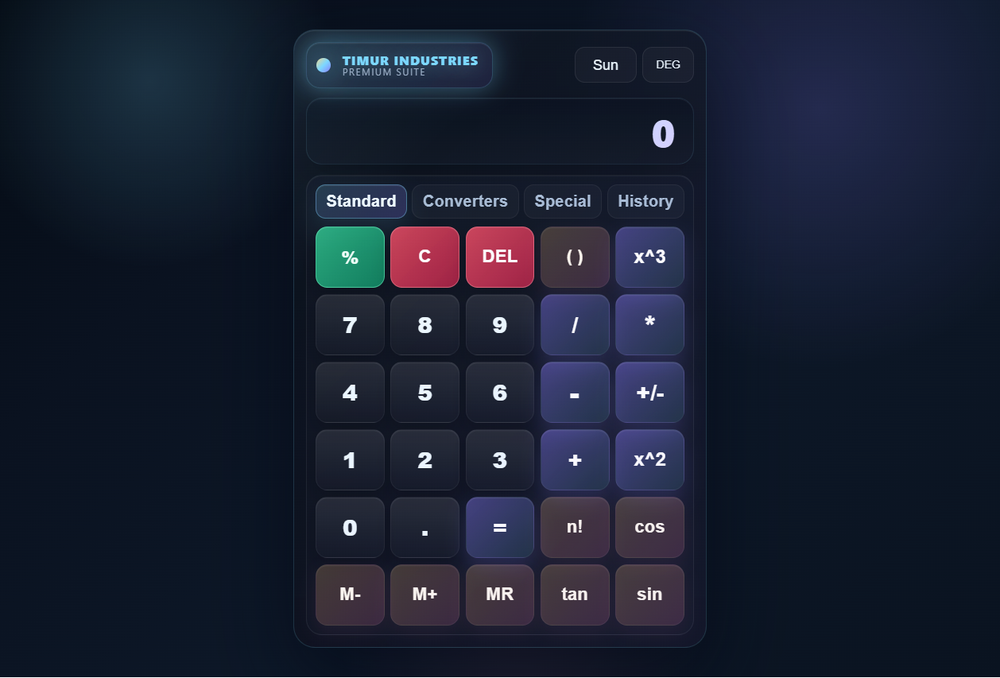

# Timur Industries Calculator

Многофункциональный калькулятор с научными операциями, конвертером единиц и вспомогательными расчётами.

## Демо

[Открыть калькулятор на GitHub Pages](https://timocha47.github.io/congenial-octo-eureka/)

## Интерфейс

## Структура проекта

- `index.html` — HTML-разметка и точка входа. Файл остаётся в корне для GitHub Pages и запуска напрямую в браузере.
- `css/` — стили: `base.css` для базовых правил, `calculator.css` для калькулятора, `panels.css` для панелей.
- `js/` — все JavaScript-файлы проекта:
  - `math.js` — форматирование чисел и математические вычисления.
  - `validation.js` — проверка и разбор числового ввода.
  - `animations.js` — анимации интерфейса.
  - `calculator.js` — логика калькулятора, памяти, истории, клавиатуры и дополнительных панелей.
  - `app.js` — запуск приложения после загрузки страницы.
- `README.md` — описание проекта и инструкции.
- `images/` — изображение интерфейса для этого описания.

Скрипты подключаются как обычные скрипты в `index.html`, в порядке зависимостей. ES-модули, сборщик и сервер для запуска не используются.

## Запуск

Откройте `index.html` в браузере или опубликуйте репозиторий через GitHub Pages. Поддерживается запуск напрямую через `file://`.
