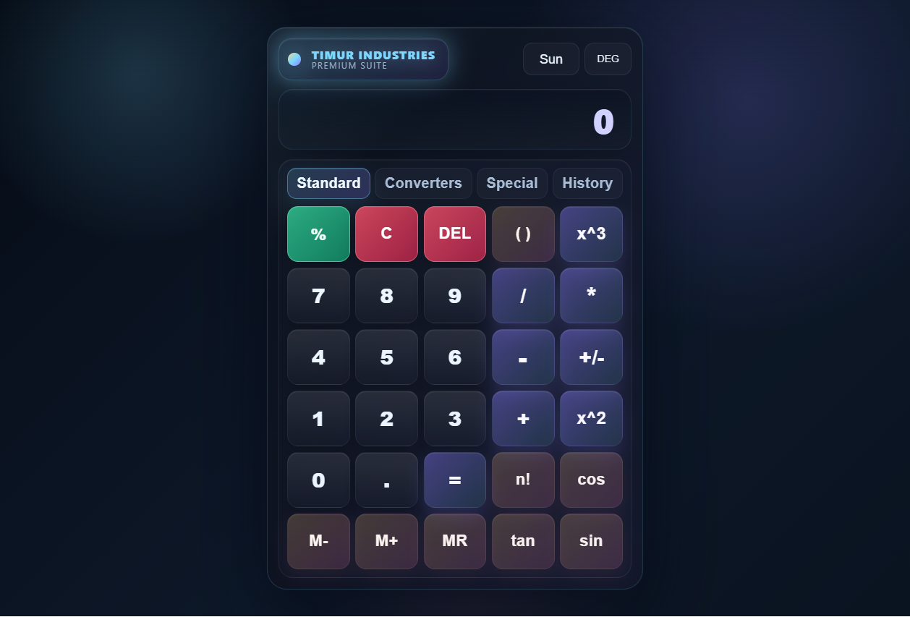

# Timur Industries Calculator

Многофункциональный калькулятор с научными операциями, конвертером единиц и вспомогательными расчётами.

## Демо

[Открыть калькулятор на GitHub Pages](https://timocha47.github.io/congenial-octo-eureka/)

## Интерфейс

## Структура проекта

- `index.html` — HTML-разметка и точка входа. Файл остаётся в корне для GitHub Pages и запуска напрямую в браузере.
- `css/` — стили: `base.css` для базовых правил, `calculator.css` для калькулятора, `panels.css` для панелей.
- `js/` — все JavaScript-файлы проекта:
  - `math.js` — форматирование чисел и математические вычисления.
  - `validation.js` — проверка и разбор числового ввода.
  - `animations.js` — анимации интерфейса.
  - `calculator.js` — логика калькулятора, памяти, истории, клавиатуры и дополнительных панелей.
  - `app.js` — запуск приложения после загрузки страницы.
- `electron/` — Windows-приложение с отдельным окном без интерфейса браузера.
- `native/` — общие веб-ресурсы и проекты Android/iOS на Capacitor.
- `scripts/copy-web-assets.cjs` — подготовка файлов калькулятора для мобильных приложений.
- `package.json` и `capacitor.config.json` — настройки сборки Windows, Android и iOS.
- `README.md` — описание проекта и инструкции.
- `images/` — изображение интерфейса для этого описания.

Скрипты подключаются как обычные скрипты в `index.html`, в порядке зависимостей. ES-модули, сборщик и сервер для запуска не используются.

## Запуск

Откройте `index.html` в браузере или опубликуйте репозиторий через GitHub Pages. Прямой запуск через `file://` по-прежнему подходит для обычного использования, но установка PWA и работа service worker требуют HTTPS или локального веб-сервера (`localhost`). Установка зависимостей для приложений: `npm install`.

## Установка на устройство

Откройте опубликованный сайт в поддерживаемом браузере и нажмите кнопку со стрелкой в верхней панели либо выберите команду установки в меню браузера. На iPhone и iPad откройте сайт в Safari, нажмите «Поделиться» и выберите «На экран Домой». После первой загрузки приложение сможет открываться офлайн.

## Отдельные приложения без открытия браузера

### Windows

- `npm start` — запустить отдельное окно приложения для проверки.
- `npm run dist:windows` — создать установщик Windows с ярлыками и портативный `.exe` в папке `release/`.
- `npm run dist:windows:installer` и `npm run dist:windows:portable` — собрать только выбранный вариант.

### Android и iPhone

- `npm run generate:native:assets` — создать значки мобильных приложений из `assets/icon.png`.
- `npm run build:android` — собрать Android-приложение с помощью Capacitor и Android SDK.
- `npm run open:android` — открыть проект Android в Android Studio для разработки или публикации.
- `npm run build:ios` — собрать приложение с помощью Capacitor и Xcode на Mac.
- `npm run open:ios` — открыть проект iOS в Xcode на Mac.

Для сборки и публикации Android необходимы Android Studio, Android SDK и JDK. Для сборки и публикации iOS необходимы Mac и Xcode; сборка iPhone-приложения на Windows не поддерживается. Проекты Android и iOS используют общие файлы калькулятора в `native/www/`.

В Android-приложении пункт **Open-source licenses** внизу экрана открывает сформированный при сборке список сторонних библиотек и тексты их лицензий. Список обновляет официальный Google OSS Licenses Gradle Plugin на основании метаданных зависимостей; лицензия Capacitor Android, который подключён как локальный Gradle-проект, добавляется отдельно из официального файла npm-пакета.
